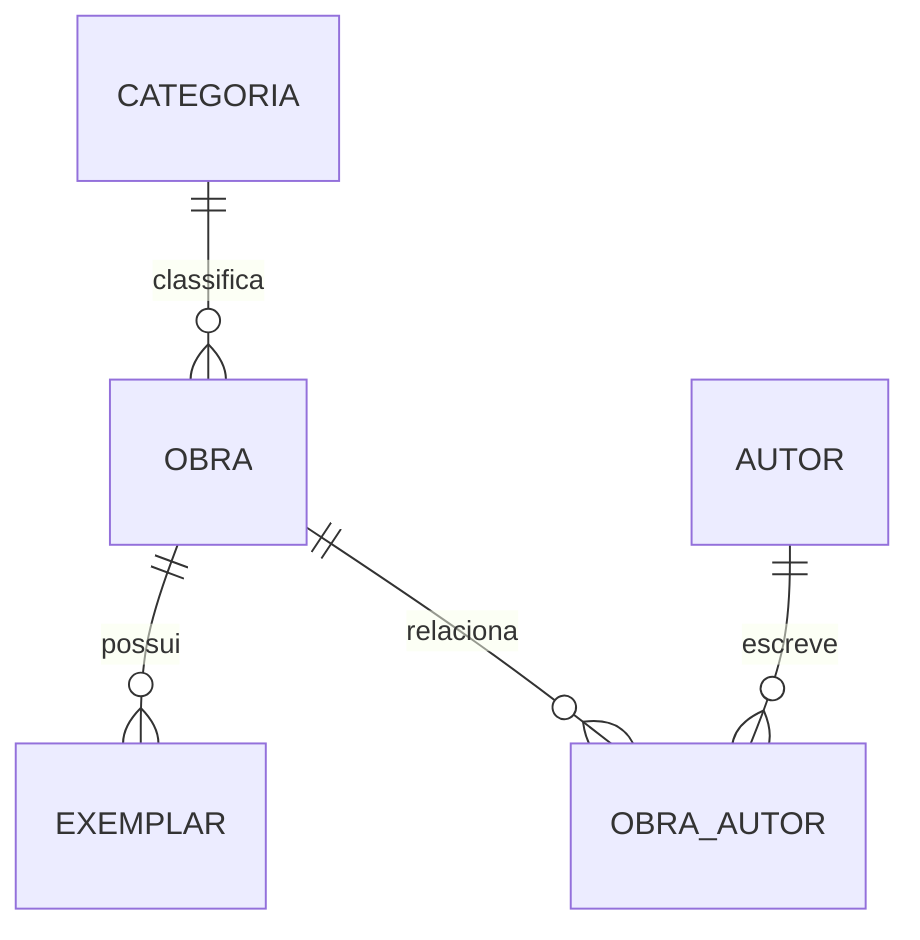

# Contexto técnico — acervo-catalogo

Trechos temáticos do README da main. Confira o código e o README vigente se o contrato tiver mudado.

## Rotas

As rotas abaixo usam o prefixo `/acervo/api/v1`.

| Método | Caminho | Operação |
| --- | --- | --- |
| GET / POST | `/categorias` | Listar e cadastrar categorias |
| GET / POST | `/autores` | Listar e cadastrar autores |
| GET / POST | `/obras` | Listar e cadastrar obras |
| GET / PUT / DELETE | `/obras/{id}` | Consultar, editar ou excluir uma obra sem exemplares |
| GET | `/obras/resumo?ids={id1},{id2}` | Consultar até 100 obras por ID em uma chamada |
| GET / POST | `/obras/{obraId}/exemplares` | Listar e cadastrar cópias físicas da obra |
| PUT | `/obras/{obraId}/capa` | Enviar ou substituir a capa |

As consultas exigem um token de leitor ou bibliotecário. Cadastros e envio de capas exigem o perfil `BIBLIOTECARIO`. No Swagger, use **Authorize** com um `access_token` emitido pelo Keycloak para a audiência `bibliogest-acervo`.

O upload recebe um formulário `multipart/form-data` com o campo `arquivo`. Aceita JPEG e PNG de até 5 MB e 2048 × 2048 pixels. A resposta da obra inclui `capaUrl`, que aponta para a imagem pública em `/acervo/capas/{obraId}.jpg`.

Localmente, as capas ficam em `.local/acervo/capas/`. A variável `BIBLIOGEST_CAPAS_DIR` altera o diretório base. No RKE2, o volume `acervo-capas` é montado em `/data`, com os arquivos em `/data/capas/`.

### Modelo de dados

| Tabela | Colunas e restrições |
| --- | --- |
| categoria | id UUID PK; nome VARCHAR(100) NOT NULL |
| autor | id UUID PK; nome VARCHAR(100) NOT NULL |
| obra | id UUID PK; titulo VARCHAR(100); categoria_id UUID FK obrigatória; volume VARCHAR(50) opcional; isbn VARCHAR(30) opcional; capa_chave VARCHAR(120) opcional; descricao TEXT opcional, até 5000 caracteres |
| obra_autor | obra_id UUID FK, autor_id UUID FK; chave primária composta pelos dois IDs |
| exemplar | id UUID PK; obra_id UUID FK obrigatória; codigo_tombo VARCHAR(100) NOT NULL UNIQUE |

PK identifica unicamente o registro, FK garante integridade referencial. Uma categoria classifica várias obras, uma obra possui vários exemplares e obras/autores têm relação muitos-para-muitos. O título é obrigatório. Exclusão de obra com exemplares é rejeitada. Disponibilidade de circulação pertence ao serviço Reservas.

| Migration | Mudança |
| --- | --- |
| V1__create_acervo_tables.sql | Cria catálogo, relacionamentos e restrição de tombo |
| V2__add_capa_to_obra.sql | Acrescenta a referência de capa |
| V3__add_descricao_to_obra.sql | Acrescenta descrição e limite de 5000 caracteres |

Arquivos reais: [db/migration](../../../../src/main/resources/db/migration). Flyway versiona o esquema; Hibernate o valida. Não se editam migrations já aplicadas.
