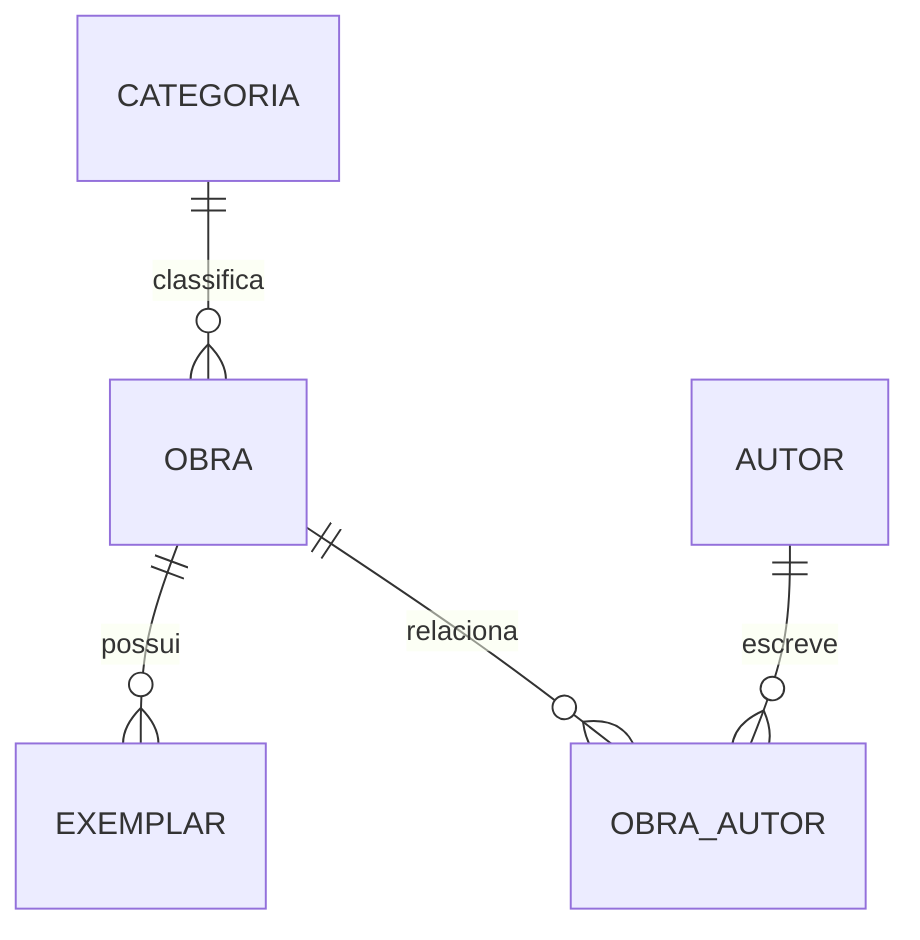

# Contexto técnico — acervo-postgres-flyway

Trechos temáticos do README da main. Confira o código e o README vigente se o contrato tiver mudado.

### Modelo de dados

| Tabela | Colunas e restrições |
| --- | --- |
| categoria | id UUID PK; nome VARCHAR(100) NOT NULL |
| autor | id UUID PK; nome VARCHAR(100) NOT NULL |
| obra | id UUID PK; titulo VARCHAR(100); categoria_id UUID FK obrigatória; volume VARCHAR(50) opcional; isbn VARCHAR(30) opcional; capa_chave VARCHAR(120) opcional; descricao TEXT opcional, até 5000 caracteres |
| obra_autor | obra_id UUID FK, autor_id UUID FK; chave primária composta pelos dois IDs |
| exemplar | id UUID PK; obra_id UUID FK obrigatória; codigo_tombo VARCHAR(100) NOT NULL UNIQUE |

PK identifica unicamente o registro, FK garante integridade referencial. Uma categoria classifica várias obras, uma obra possui vários exemplares e obras/autores têm relação muitos-para-muitos. O título é obrigatório. Exclusão de obra com exemplares é rejeitada. Disponibilidade de circulação pertence ao serviço Reservas.

| Migration | Mudança |
| --- | --- |
| V1__create_acervo_tables.sql | Cria catálogo, relacionamentos e restrição de tombo |
| V2__add_capa_to_obra.sql | Acrescenta a referência de capa |
| V3__add_descricao_to_obra.sql | Acrescenta descrição e limite de 5000 caracteres |

Arquivos reais: [db/migration](../../../../src/main/resources/db/migration). Flyway versiona o esquema; Hibernate o valida. Não se editam migrations já aplicadas.

### SQL Injection no Acervo

Os repositories estendem JpaRepository; ObraRepository também usa JpaSpecificationExecutor. ObraFiltros constrói a busca com Criteria API e valores de filtro tratados pela camada JPA, incluindo escape de caracteres especiais de LIKE. IDs UUID e DTOs são validados. Não se concatena entrada do usuário em comandos SQL. A configuração de segurança valida a audiência bibliogest-acervo.
