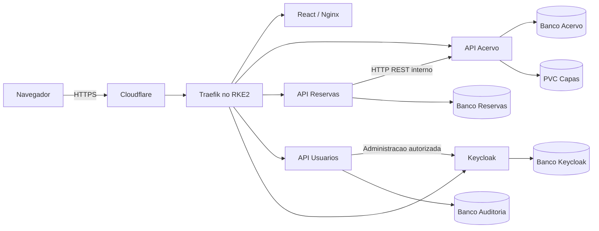

# Contexto técnico — acervo-rke2-infra

Trechos temáticos do README da main. Confira o código e o README vigente se o contrato tiver mudado.

## Arquitetura do BiblioGest

O BiblioGest é uma aplicação de gestão de bibliotecas baseada em microsserviços REST. Cada serviço tem uma responsabilidade e persistência próprias. O Keycloak centraliza identidade e autenticação; a integração entre serviços ocorre por HTTP, sem compartilhar entidades JPA ou consultar diretamente o banco de outro microsserviço.

Os bancos lógicos são independentes, hospedados na instância PostgreSQL do projeto. As capas ficam em volume persistente; o banco de Acervo guarda a referência. O ambiente usa Docker para construção de imagens, containerd e Kubernetes RKE2 para execução, Rancher para gerenciamento, Traefik para roteamento, Nginx para frontend e Cloudflare na borda. GitHub Actions executa validações e build; o deploy é uma operação separada. O pgAdmin é ferramenta de administração do banco, não parte do acesso do leitor.

| Componente | Responsabilidade | Repositório |
| --- | --- | --- |
| Frontend | Catálogo, reservas, balcão e administração | [bibliogest-frontend](https://github.com/ksferreira35/bibliogest-frontend) |
| Acervo | Obras, autores, categorias, exemplares e capas | [bibliogest-acervo](https://github.com/ksferreira35/bibliogest-acervo) |
| Reservas | Disponibilidade e circulação dos exemplares | [bibliogest-reservas](https://github.com/ksferreira35/bibliogest-reservas) |
| Usuários | Administração de contas e auditoria | [bibliogest-usuarios](https://github.com/ksferreira35/bibliogest-usuarios) |

### Capas e integração

O conteúdo da capa fica no volume persistente; o banco só guarda capa_chave. Upload autenticado de bibliotecário valida formato, tamanho e dimensões; o endpoint público de capa entrega a imagem ao catálogo. Reservas usa listagem de exemplares e resumo de obras por HTTP, e mantém suas próprias informações de circulação. Os manifests compartilhados ficam em [deploy/k8s](../../../../deploy/k8s).
