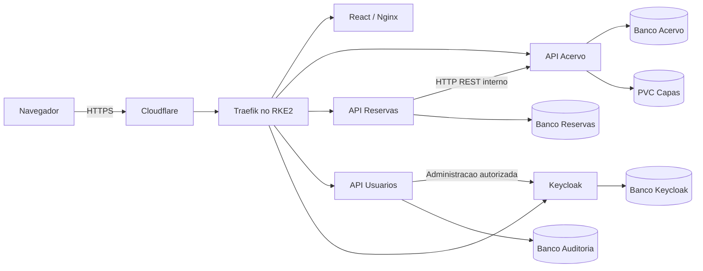
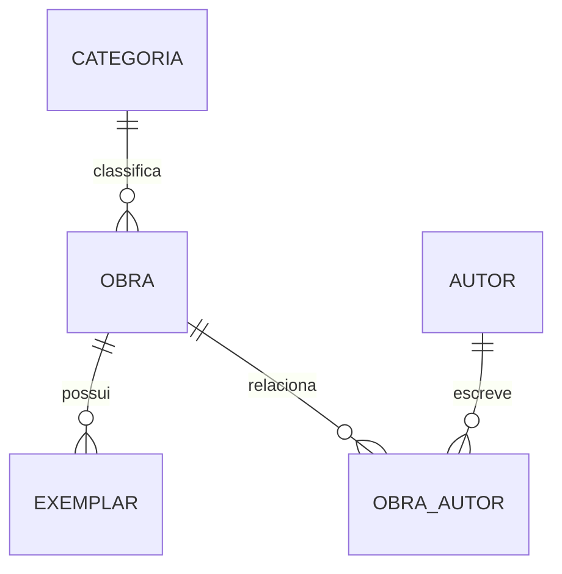

# BiblioGest — Acervo

API para cadastrar e consultar obras, autores, categorias e exemplares físicos de uma biblioteca. Também recebe e disponibiliza as capas das obras.

Java 21, Spring Boot, Spring Data JPA, PostgreSQL, Flyway e Keycloak.

## Desenvolvimento local

Use Java 21, Maven e um banco PostgreSQL próprio para desenvolvimento. Configure um arquivo `.env` na raiz do projeto com os valores do seu ambiente.

```dotenv
SPRING_PROFILES_ACTIVE=local
DB_URL=jdbc:postgresql://127.0.0.1:15432/bibliogest_acervo
DB_USERNAME=seu_usuario_local
DB_PASSWORD=sua_senha_local
OIDC_ISSUER_URI=https://login.ksferreira.org/realms/bibliogest
OIDC_JWK_SET_URI=https://login.ksferreira.org/realms/bibliogest/protocol/openid-connect/certs
```

No IntelliJ, selecione o `.env` nas variáveis de ambiente da configuração de execução. Pelo terminal, carregue o arquivo antes de iniciar a aplicação.

```bash
set -a
source .env
set +a
mvn spring-boot:run
```

O Flyway aplica as migrations ao iniciar. O Hibernate valida o esquema criado.

- [Swagger local](http://localhost:8080/acervo/swagger-ui/index.html)
- [Saúde da API e do banco](http://localhost:8080/acervo/actuator/health/readiness)
- [BiblioGest publicado](https://bibliogest.ksferreira.org/)

## Rotas

As rotas abaixo usam o prefixo `/acervo/api/v1`.

| Método | Caminho | Operação |
| --- | --- | --- |
| GET / POST | `/categorias` | Listar e cadastrar categorias |
| GET / POST | `/autores` | Listar e cadastrar autores |
| GET / POST | `/obras` | Listar e cadastrar obras |
| GET / PUT / DELETE | `/obras/{id}` | Consultar, editar ou excluir uma obra sem exemplares |
| GET | `/obras/resumo?ids={id1},{id2}` | Consultar até 100 obras por ID em uma chamada |
| GET / POST | `/obras/{obraId}/exemplares` | Listar e cadastrar cópias físicas da obra |
| PUT | `/obras/{obraId}/capa` | Enviar ou substituir a capa |

As consultas exigem um token de leitor ou bibliotecário. Cadastros e envio de capas exigem o perfil `BIBLIOTECARIO`. No Swagger, use **Authorize** com um `access_token` emitido pelo Keycloak para a audiência `bibliogest-acervo`.

O upload recebe um formulário `multipart/form-data` com o campo `arquivo`. Aceita JPEG e PNG de até 5 MB e 2048 × 2048 pixels. A resposta da obra inclui `capaUrl`, que aponta para a imagem pública em `/acervo/capas/{obraId}.jpg`.

Localmente, as capas ficam em `.local/acervo/capas/`. A variável `BIBLIOGEST_CAPAS_DIR` altera o diretório base. No RKE2, o volume `acervo-capas` é montado em `/data`, com os arquivos em `/data/capas/`.

## Testes e build

```bash
mvn verify
```

Os testes usam H2 em memória e tokens simulados. O GitHub Actions executa os testes antes do build.

O Dockerfile gera a imagem da API. Os manifests do homelab ficam em `deploy/k8s/`. A API de Reservas consulta os exemplares por HTTP e mantém a disponibilidade e as reservas no próprio banco.

O catálogo `GET /obras` retorna `{content, pagina, tamanho, totalElementos, totalPaginas}`. Use `pagina` (inicia em 0), `tamanho` (padrão 20, máximo 100), `busca` (título, autor, categoria ou ISBN) e `categoriaId`. A ordenação é por título e ID.

`PUT /obras/{id}` recebe o mesmo corpo do cadastro e substitui título, categoria, autores, volume e ISBN, preservando ID, capa e exemplares. Volume e ISBN omitidos são limpos. Edição e exclusão exigem `BIBLIOTECARIO`; exclusão com exemplares retorna `409` para preservar as referências usadas pelas reservas.

O cadastro e a edição de obras aceitam `descricao`, um texto opcional de até 5.000 caracteres para a sinopse. O campo é retornado nas consultas; valores vazios são armazenados como `null`. No PUT, omitir a descrição ou enviar `null` remove a sinopse anterior.


## Qualidade e cobertura obrigatória

A configuração de cobertura fica no `pom.xml`, com **JaCoCo 0.8.16**. Para rodar a mesma verificação usada no CI, use Java 21:

```bash
./mvnw --batch-mode --no-transfer-progress clean verify
```

A fase `validate` verifica Checkstyle; a fase `test` executa JUnit; `verify` gera o relatório JaCoCo e reprova o build se a cobertura global ficar abaixo de **80% de linhas ou 80% de branches**. Todos os testes também precisam passar. Não basta executar `mvn test` para validar o limite, porque a regra é cobrada em `verify`.

| Arquivo gerado | Uso |
| --- | --- |
| `target/site/jacoco/index.html` | Relatório navegável por pacote, classe e linha |
| `target/site/jacoco/jacoco.xml` | Totais e integração com analisadores |
| `target/jacoco.exec` | Dados de execução coletados pelo agente |
| `target/surefire-reports/` | Resultados de cada teste JUnit |

O JaCoCo mede todas as classes compiladas da aplicação; não há exclusão de services, controllers, DTOs ou configuração de segurança para aumentar a cobertura. `target/` é ignorado pelo Git e não vai para o repositório. A cobertura mede execução de código, não garante ausência de bugs; os testes verificam resultados e erros esperados.

### GitHub Actions

O workflow `.github/workflows/ci.yml` executa:

```text
lint (Checkstyle) → testes + cobertura (clean verify) → empacotamento
```

Os jobs usam `needs`, portanto o empacotamento não começa quando um teste, lint ou limite de cobertura falhar. O último job usa `-DskipTests package`: ele empacota o mesmo código já verificado pelo job anterior, sem tentar validar cobertura em uma máquina sem os dados da execução anterior.

O resumo da execução mostra as porcentagens de linhas e branches. Em **Actions → execução → Artifacts → coverage-and-tests**, baixe o relatório HTML e os resultados JUnit. Os arquivos são publicados também em caso de reprovação e ficam disponíveis por 14 dias. O workflow roda em push para `main` e esta branch de implementação, além de pull requests para `main`.

Os testes não usam credenciais de produção e não fazem login em contas reais. Os testes de segurança fornecem JWTs simulados ao decoder de teste e verificam roles válidas, ausência de roles e claims malformadas. Somente `LEITOR` e `BIBLIOTECARIO`, com os nomes exatos, recebem permissões da aplicação. O marcador de autenticação Bearer do Spring não equivale a uma role administrativa.

O Cypress fica no [repositório do frontend](https://github.com/ksferreira35/bibliogest-frontend), onde testa os fluxos em navegador e acessibilidade. Nesta API, os testes usam JUnit, MockMvc e testes de integração; não é necessário outro repositório nem um navegador para medir a cobertura Java. Referência: [regra check do JaCoCo](https://www.jacoco.org/jacoco/trunk/doc/check-mojo.html).

### Segurança e integração com o navegador

O backend valida o token Bearer e aplica as permissões do Spring Security; as regras do frontend não substituem essa validação. Os dados privados continuam em variáveis locais ou Secrets do Kubernetes. `.env` e credenciais reais não devem ser incluídos em commits nem imagens; `.env.example` documenta somente as configurações de desenvolvimento.

O frontend e esta API usam a mesma origem em produção, com caminhos separados no Ingress. Não foi adicionada uma liberação genérica de CORS. Para desenvolvimento, use o proxy do Vite no frontend. Caso a API seja servida em outra origem no futuro, configure apenas as origens autorizadas, mantendo a validação de tokens.

A CSP é entregue pelo Nginx do frontend, junto do documento HTML. Esta API retorna JSON e não injeta a interface nem os controles de acessibilidade. Os READMEs do frontend detalham a política e a auditoria WCAG com Cypress/axe.

### Cenários de teste do Acervo

As suítes verificam cadastro, consulta, edição, exclusão com vínculos, paginação, filtros, sinopse, exemplares, permissões e respostas de erro. Os testes de capas cobrem tamanho/formato/dimensões, armazenamento, caminho inválido e conversão para JPEG. As migrations são executadas sobre H2 em modo PostgreSQL; o teste de descrição também verifica atualização de um esquema com dados anteriores. H2 facilita a execução local e não substitui a validação de migrations no PostgreSQL antes do deploy.

A rotina de cobertura não precisa do PostgreSQL local nem de variáveis de produção. Os testes de integração definem um banco H2 isolado; as capas são gravadas em diretórios temporários.

## Arquitetura do BiblioGest

O BiblioGest é uma aplicação de gestão de bibliotecas baseada em microsserviços REST. Cada serviço tem uma responsabilidade e persistência próprias. O Keycloak centraliza identidade e autenticação; a integração entre serviços ocorre por HTTP, sem compartilhar entidades JPA ou consultar diretamente o banco de outro microsserviço.



Os bancos lógicos são independentes, hospedados na instância PostgreSQL do projeto. As capas ficam em volume persistente; o banco de Acervo guarda a referência. O ambiente usa Docker para construção de imagens, containerd e Kubernetes RKE2 para execução, Rancher para gerenciamento, Traefik para roteamento, Nginx para frontend e Cloudflare na borda. GitHub Actions executa validações e build; o deploy é uma operação separada. O pgAdmin é ferramenta de administração do banco, não parte do acesso do leitor.

| Componente | Responsabilidade | Repositório |
| --- | --- | --- |
| Frontend | Catálogo, reservas, balcão e administração | [bibliogest-frontend](https://github.com/ksferreira35/bibliogest-frontend) |
| Acervo | Obras, autores, categorias, exemplares e capas | [bibliogest-acervo](https://github.com/ksferreira35/bibliogest-acervo) |
| Reservas | Disponibilidade e circulação dos exemplares | [bibliogest-reservas](https://github.com/ksferreira35/bibliogest-reservas) |
| Usuários | Administração de contas e auditoria | [bibliogest-usuarios](https://github.com/ksferreira35/bibliogest-usuarios) |

## Organização interna e persistência

Java 21, Spring Boot, Spring Security, Spring Data JPA/Hibernate, PostgreSQL e Flyway. Controllers recebem DTOs, services aplicam regras, repositories persistem via JPA; o tratamento de exceções fica na camada web. A API usa UUIDs e mantém os relacionamentos do catálogo.

### Modelo de dados



| Tabela | Colunas e restrições |
| --- | --- |
| categoria | id UUID PK; nome VARCHAR(100) NOT NULL |
| autor | id UUID PK; nome VARCHAR(100) NOT NULL |
| obra | id UUID PK; titulo VARCHAR(100); categoria_id UUID FK obrigatória; volume VARCHAR(50) opcional; isbn VARCHAR(30) opcional; capa_chave VARCHAR(120) opcional; descricao TEXT opcional, até 5000 caracteres |
| obra_autor | obra_id UUID FK, autor_id UUID FK; chave primária composta pelos dois IDs |
| exemplar | id UUID PK; obra_id UUID FK obrigatória; codigo_tombo VARCHAR(100) NOT NULL UNIQUE |

PK identifica unicamente o registro, FK garante integridade referencial. Uma categoria classifica várias obras, uma obra possui vários exemplares e obras/autores têm relação muitos-para-muitos. O título é obrigatório. Exclusão de obra com exemplares é rejeitada. Disponibilidade de circulação pertence ao serviço Reservas.

| Migration | Mudança |
| --- | --- |
| V1__create_acervo_tables.sql | Cria catálogo, relacionamentos e restrição de tombo |
| V2__add_capa_to_obra.sql | Acrescenta a referência de capa |
| V3__add_descricao_to_obra.sql | Acrescenta descrição e limite de 5000 caracteres |

Arquivos reais: [db/migration](src/main/resources/db/migration). Flyway versiona o esquema; Hibernate o valida. Não se editam migrations já aplicadas.

### SQL Injection no Acervo

Os repositories estendem JpaRepository; ObraRepository também usa JpaSpecificationExecutor. ObraFiltros constrói a busca com Criteria API e valores de filtro tratados pela camada JPA, incluindo escape de caracteres especiais de LIKE. IDs UUID e DTOs são validados. Não se concatena entrada do usuário em comandos SQL. A configuração de segurança valida a audiência bibliogest-acervo.

### Capas e integração

O conteúdo da capa fica no volume persistente; o banco só guarda capa_chave. Upload autenticado de bibliotecário valida formato, tamanho e dimensões; o endpoint público de capa entrega a imagem ao catálogo. Reservas usa listagem de exemplares e resumo de obras por HTTP, e mantém suas próprias informações de circulação. Os manifests compartilhados ficam em [deploy/k8s](deploy/k8s).

## Matriz de permissões

As roles são atribuídas no Keycloak e verificadas nas APIs. Uma conta pode acumular roles; ADMINISTRADOR por si só não equivale a LEITOR ou BIBLIOTECARIO.

| Operação | LEITOR | BIBLIOTECARIO | ADMINISTRADOR |
| --- | --- | --- | --- |
| Consultar catálogo e disponibilidade | Sim | Sim | Se também leitor/bibliotecário |
| Criar reserva pessoal | Sim | Se também leitor | Se também leitor |
| Consultar reservas próprias | Sim | Sim | Se também leitor/bibliotecário |
| Cancelar reserva aguardando retirada | Própria | Sim | Conforme outras roles |
| Consultar balcão, registrar retirada/devolução | Não | Sim | Se também bibliotecário |
| Cadastrar e editar acervo | Não | Sim | Se também bibliotecário |
| Administrar contas e consultar auditoria | Não | Não | Sim |

A ausência de autenticação válida leva a 401; uma role insuficiente leva a 403. Consultas a reservas de terceiros sem autorização devolvem 404 conforme o contrato. IDs técnicos identificam recursos; não substituem autorização.

## Segurança em camadas

| Controle | Implementação e finalidade |
| --- | --- |
| Autenticação | Keycloak, OAuth 2.0/OIDC, PKCE S256 no frontend; tokens JWT Bearer nas APIs. |
| Autorização | Spring Security verifica assinatura, emissor, audiência e expiração; roles e propriedade dos recursos são avaliadas no backend. |
| SQL Injection | Dados de entrada são tratados como valores tipados em consultas parametrizadas nos repositories, não como trechos de SQL. Validação de entrada complementa essa proteção. |
| XSS | React renderiza conteúdo textual com escape; CSP no Nginx limita recursos autorizados no navegador. |
| CSRF | As APIs são stateless e autorizam via Bearer explícito, não por cookie de sessão enviado automaticamente. CSRF do Spring está desativado para esse modelo. Isso não elimina os controles do Keycloak no login. |
| CORS | APIs e frontend usam a mesma origem pública; os caminhos são roteados pelo Ingress. Vite usa proxy no desenvolvimento. Web Origins do Keycloak é configurado no cliente, sem liberação genérica. CORS não substitui autenticação. |
| Clickjacking | Nginx envia X-Frame-Options DENY e CSP frame-ancestors none. |
| Transporte | HTTPS público, HSTS no frontend e Cloudflare na borda. |
| Segredos e rede | Credenciais via ambiente/Secrets, banco e serviços internos com escopo de rede e contas separadas. Swagger fica desabilitado em produção. |

Esses controles reduzem riscos, mas não constituem certificação de ausência de vulnerabilidades. O projeto mantém testes defensivos, validação e revisão dos contratos. Não use produção nem credenciais reais em testes automatizados.

## Skills para agentes de IA
As skills estão em `.agents/skills/`. Cada pasta contém um `SKILL.md` com contexto, regras e orientação de manutenção. São instruções de desenvolvimento para agentes, não funcionalidades de IA em execução no sistema.

| Skill | Finalidade |
| --- | --- |
| [acervo-capas](.agents/skills/acervo-capas/SKILL.md) | Manter upload de capas, validação de imagens e armazenamento persistente do Acervo. |
| [acervo-catalogo](.agents/skills/acervo-catalogo/SKILL.md) | Implementar regras de categorias, autores, obras, exemplares, descrição e paginação do catálogo. |
| [acervo-postgres-flyway](.agents/skills/acervo-postgres-flyway/SKILL.md) | Manter persistência PostgreSQL, schema e migrations Flyway da API de acervo. |
| [acervo-rke2-infra](.agents/skills/acervo-rke2-infra/SKILL.md) | Manter os manifests compartilhados do BiblioGest: Kubernetes RKE2, Traefik, PostgreSQL, Keycloak, PVCs e frontend. |
| [acervo-seguranca-jwt](.agents/skills/acervo-seguranca-jwt/SKILL.md) | Manter autenticação e autorização defensiva Spring Security/Keycloak na API de acervo. |
| [acervo-spring-boot](.agents/skills/acervo-spring-boot/SKILL.md) | Implementar controllers, DTOs, serviços e tratamento de erros Java/Spring Boot da API de acervo. |
| [acervo-testes-ci](.agents/skills/acervo-testes-ci/SKILL.md) | Validar a API de acervo com JUnit, MockMvc, Mockito, Checkstyle, JaCoCo e GitHub Actions. |
