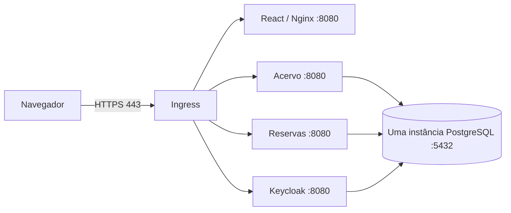

# Implantação do BiblioGest

**Para executar com sudo no servidor RKE2, comece pelo [guia RKE2 e pgAdmin](RKE2.md).** Ele contém o comando único de build/implantação, a opção sem registry e o acesso ao pgAdmin.

Base para a fase inicial dos três repositórios. **A implantação no servidor e os testes reais de login ainda não foram executados.** O ambiente de preparação bloqueou a conexão com Kubernetes, o acesso ao registry npm e a execução de containers. Não foram criados Secrets, bancos, usuários ou recursos no servidor.

A infraestrutura compartilhada fica neste diretório do repositório `bibliogest-acervo`, para que seja versionada em um dos três repositórios existentes. Cada aplicação tem seu próprio Dockerfile e Deployment; não é necessário reconstruir ou atualizar as outras aplicações. Não há repositório Git válido na pasta que agrupa os três projetos.

**Revisão das APIs com os bancos já provisionados:** [PostgreSQL, build e verificação sem escrita](POSTGRESQL.md).

## Estrutura encontrada

| Repositório | Pasta nesta máquina | Situação inicial |
| --- | --- | --- |
| bibliogest-acervo | `microsservices/acervo-api` | Spring Boot 4.1.2, Java 21, Maven Wrapper, sem operações de negócio |
| bibliogest-reservas | `microsservices/reservas-api` | Spring Boot 4.1.2, Java 21, Maven Wrapper, sem operações de negócio |
| bibliogest-frontend | `front/bibliogest-frontend` | React 19, Vite 8, template inicial |

As versões originais dos frameworks foram preservadas. Os Dockerfiles das APIs executam `mvn verify`; o do frontend executa `npm ci`, lint e build. Os testes Java foram preparados, mas não executados porque não há JDK/Maven utilizáveis neste ambiente.

Existe um contexto Kubernetes `default`, apontando para `https://127.0.0.1:6443`. A conexão falhou com `socket: operation not permitted`. Também não foi possível consultar os sockets de rede ou executar Podman. Por isso, nós, recursos alocáveis, CNI, Ingress, volumes, portas públicas e certificados continuam **sem confirmação**. A leitura local mostrou 36 CPUs lógicas visíveis, aproximadamente 31 GiB de RAM total, 20 GiB disponíveis e 675 GiB livres no filesystem da pasta de trabalho. Esses valores do host não comprovam capacidade alocável ou livre no cluster.

## Arquitetura e portas



Frontend e APIs compartilham o domínio da aplicação; o login usa outro hostname. As APIs têm os contextos `/acervo` e `/reservas`. O Ingress encaminha somente `/acervo/api` e `/reservas/api`, preservando os caminhos. Não há reescrita, CORS entre frontend e APIs nem necessidade de expor Actuator/Swagger. A porta 9000 do Keycloak é exclusiva de probes. Todos os Services são ClusterIP; não há NodePort, hostPort ou LoadBalancer para PostgreSQL.

O PostgreSQL usa um StatefulSet de uma réplica, executa como o usuário postgres (UID/GID 999), usa fsGroup 999 para o volume e mantém um PVC de 20 GiB. O provisionador precisa suportar essas permissões. Há três bancos:

| Banco e usuário | Secret consumido | Aplicação |
| --- | --- | --- |
| bibliogest_acervo | acervo-db | Acervo |
| bibliogest_reservas | reservas-db | Reservas |
| bibliogest_keycloak | keycloak-db | Keycloak |

O Job `database-init` cria os bancos e os usuários sem privilégios de superusuário, criação de bancos ou criação de roles. Remove acesso concedido a PUBLIC. O `pg_hba.conf` permite cada usuário apenas no próprio banco, inclusive se privilégios SQL forem modificados no banco pertencente à aplicação. O superusuário separado serve à administração e ao provisionamento.

NetworkPolicies negam entrada por padrão e permitem PostgreSQL apenas às duas APIs, ao Keycloak, ao pgAdmin e aos Jobs de banco. O controller de Ingress é identificado por namespace **e** label, parametrizados. As APIs consultam as chaves do Keycloak pela rede interna, mas validam o emissor público HTTPS. **Confirme que o CNI aplica NetworkPolicy.** Um controller com `hostNetwork` exige ajustar as políticas à rede real; o script interrompe esse caso.

| Variável | Origem em produção |
| --- | --- |
| DB_URL | Deployment de cada API, apontando para seu banco no Service postgres |
| DB_USERNAME / DB_PASSWORD | Secret individual da API |
| OIDC_ISSUER_URI | ConfigMap, `https://DOMINIO_LOGIN/realms/bibliogest` |
| OIDC_JWK_SET_URI | ConfigMap, endpoint de chaves interno do Keycloak |
| KC_DB_URL / KC_DB_USERNAME / KC_DB_PASSWORD | Deployment e Secret exclusivo do Keycloak |
| KC_BOOTSTRAP_ADMIN_USERNAME / KC_BOOTSTRAP_ADMIN_PASSWORD | Secret administrativo separado |
| keycloakUrl / realm / clientId / acervoUrl / reservasUrl | `config.json` público montado no frontend; nenhum segredo |

As reservas de recursos somam aproximadamente 825 millicores e 2 GiB de RAM, além do cluster e dos Jobs. Os limites somados chegam a cerca de 4,7 GiB; disponibilize margem para o sistema e para atualizações. Estes valores são iniciais, sujeitos a medição. PostgreSQL e Keycloak têm uma réplica; indisponibilidade do nó causa indisponibilidade do serviço. `local-path` prende os dados ao nó: não oferece recuperação após perda de disco/nó. O PVC é retido em exclusão/escala do StatefulSet; não apague namespace ou PVC para atualizar aplicações.

## Arquivos

| Manifest | Recursos |
| --- | --- |
| `k8s/00-namespace.yaml` | Namespace bibliogest |
| `k8s/01-config.yaml` | Emissor, JWKS interno e configuração pública do React |
| `k8s/02-network-policies.yaml` | Acesso interno e entradas do Ingress |
| `k8s/10-postgres.yaml` | PostgreSQL 17.12, Service, HBA e PVC |
| `k8s/11-databases.yaml` | SQL e Job de criação dos três bancos |
| `k8s/20-keycloak.yaml` | Keycloak 26.8.2 e Service |
| `k8s/30-acervo.yaml` | Acervo e Service |
| `k8s/31-reservas.yaml` | Reservas e Service |
| `k8s/40-frontend.yaml` | Frontend e Service |
| `k8s/45-pgadmin.yaml` | pgAdmin 9.19, init de credenciais, PVC e Service privado |
| `k8s/pgadmin-servers.json` | Três conexões internas, sem senhas |
| `k8s/50-ingress.yaml` | Hosts, rotas e TLS |
| `k8s/realm-bibliogest.json` | Realm, perfis e cliente público |

`k8s` contém templates com `@@PARAMETROS@@`. Renderize antes de usar kubectl. `rendered/`, arquivos `*.local.json` e `.local/` são ignorados pelo Git. **Não coloque senhas na configuração JSON**: ela contém somente parâmetros públicos. Os arquivos renderizados também não contêm senhas.

## Configurar o servidor

Os comandos seguintes partem deste diretório, com Bash, Python 3, OpenSSL e kubectl. Use um kubeconfig com acesso ao cluster desejado e permissão para estes recursos. Não use o contexto desta máquina em outro servidor sem confirmar o destino.

```bash
cd microsservices/acervo-api/deploy
kubectl config get-contexts
export KUBE_CONTEXT='contexto-do-seu-servidor'
kubectl --context "$KUBE_CONTEXT" get nodes -o wide
kubectl --context "$KUBE_CONTEXT" get storageclass,ingressclass
kubectl --context "$KUBE_CONTEXT" get pods -A -o wide
kubectl --context "$KUBE_CONTEXT" get ingress,service -A
kubectl --context "$KUBE_CONTEXT" describe nodes
```

Confirme capacidade livre, CNI com NetworkPolicy e um provisionador de volumes. Se usar um cluster existente, preserve os serviços já publicados nas portas 80/443; utilize seu controller de Ingress. Confirme DNS dos dois domínios apontando ao IP público, firewall/NAT de 443 e a emissão de certificado. A porta 5432 não deve estar publicada no roteador, firewall ou outro Service do servidor.

Copie o exemplo e ajuste todos os valores. `local-path`, a classe, o namespace e a label do controller são exemplos que devem ser conferidos no RKE2. A configuração local consultada indica Traefik; a existência da StorageClass e os recursos do cluster ainda não foram confirmados. Os nomes de imagem GHCR também são exemplos; nenhuma imagem foi enviada ao registry.

```bash
cp deployment.example.json deployment.local.json
# Edite deployment.local.json com os domínios, imagens e classes reais.
python3 scripts/render.py deployment.local.json --production
kubectl kustomize rendered
```

Prepare o namespace e o Secret TLS, com certificado confiável e SANs cobrindo **ambos** os domínios. Os arquivos do certificado ficam fora do Git. Se o servidor já usa cert-manager, solicite um Certificate no namespace bibliogest com `secretName: bibliogest-tls` usando o Issuer real e aguarde Ready antes de implantar. O script não instala nem presume cert-manager/ClusterIssuer.

```bash
kubectl --context "$KUBE_CONTEXT" apply -f rendered/00-namespace.yaml
kubectl --context "$KUBE_CONTEXT" -n bibliogest create secret tls bibliogest-tls \
  --cert=/caminho-fora-do-git/fullchain.pem \
  --key=/caminho-fora-do-git/privkey.pem
```

O exemplo usa Traefik e restringe as rotas ao entrypoint `websecure` com TLS. Configure no controller existente o redirecionamento do entrypoint HTTP para HTTPS. `INGRESS_CONTROLLER=nginx` seleciona as anotações correspondentes para um Ingress NGINX existente; confira também classe/labels e o redirecionamento no servidor. O teste de publicação rejeita HTTP que entregue conteúdo sem redirecionar. Não exponha diretamente o HTTP dos pods do Keycloak: o controller deve substituir os headers X-Forwarded recebidos externamente.

Para registry privado, prepare um imagePullSecret fora do Git e associe-o ao ServiceAccount `default` no namespace bibliogest **antes** de implantar. Os pods herdam essa configuração mesmo com automount do token desativado. Não passe senhas de registry na linha de comando/histórico; use seu arquivo de configuração de login protegido ou gerenciador de segredos.

```bash
kubectl --context "$KUBE_CONTEXT" -n bibliogest create secret generic registry-credentials \
  --type=kubernetes.io/dockerconfigjson \
  --from-file=.dockerconfigjson=/caminho-protegido/config.json
kubectl --context "$KUBE_CONTEXT" -n bibliogest patch serviceaccount default \
  -p '{"imagePullSecrets":[{"name":"registry-credentials"}]}'
```

## Construir e publicar as imagens

Use Docker ou Podman em uma máquina com rede. A partir da pasta que agrupa os repositórios, por exemplo:

```bash
export REGISTRY='ghcr.io/ksferreira35'
export VERSION='0.1.0'
export ACERVO_TAG="$VERSION-$(git -C microsservices/acervo-api rev-parse --short=12 HEAD)"
export RESERVAS_TAG="$VERSION-$(git -C microsservices/reservas-api rev-parse --short=12 HEAD)"
export FRONTEND_TAG="$VERSION-$(git -C front/bibliogest-frontend rev-parse --short=12 HEAD)"

docker build -t "$REGISTRY/bibliogest-acervo:$ACERVO_TAG" microsservices/acervo-api
docker push "$REGISTRY/bibliogest-acervo:$ACERVO_TAG"
docker build -t "$REGISTRY/bibliogest-reservas:$RESERVAS_TAG" microsservices/reservas-api
docker push "$REGISTRY/bibliogest-reservas:$RESERVAS_TAG"
docker build -t "$REGISTRY/bibliogest-frontend:$FRONTEND_TAG" front/bibliogest-frontend
docker push "$REGISTRY/bibliogest-frontend:$FRONTEND_TAG"
```

Faça commit das alterações revisadas **antes** de usar o SHA na tag e não sobrescreva tags publicadas. Preencha as três imagens exatas no `deployment.local.json`; digests `@sha256:...` também são aceitos. As imagens de execução são independentes. As bases Java/Node nos Dockerfiles seguem linhas de manutenção para receber correções a cada build; para reproduzir o build byte a byte, fixe também seus digests depois de validá-los no registry. Confirme a arquitetura dos nós e publique imagens compatíveis. A tag PostgreSQL 17.12 foi lançada em 12/11/2026; confirme sua disponibilidade no registry antes da implantação.

## Validar e implantar

```bash
# Validação offline (requer PyYAML; o validador OpenAPI também requer jsonschema).
python3 -m pip install -r tests/requirements.txt
python3 -m unittest discover -s tests -v
python3 scripts/render.py deployment.local.json --production
mkdir -p .local
kubectl kustomize rendered > .local/manifests.yaml
# Usa somente os esquemas já disponíveis no cache de kubectl, se houver.
python3 tests/validate-manifests.py .local/manifests.yaml

# Validação no API server e implantação em ordem, com esperas de prontidão.
./scripts/deploy.sh "$KUBE_CONTEXT" deployment.local.json
./scripts/verify-databases.sh "$KUBE_CONTEXT"
```

A sequência é: namespace → checagens do servidor/TLS → dry-run no API server → Secrets → PostgreSQL → Job de bancos → Keycloak → APIs → frontend → pgAdmin → Ingress. O script cria o namespace; TLS é pré-requisito da publicação completa. Os componentes postgres/databases/pgadmin podem ser implantados antes de configurar domínios e TLS, conforme RKE2.md. O script gera senhas aleatórias em memória e envia Secrets diretamente ao cluster; não grava senhas no workspace nem imprime seus valores; o init container do pgAdmin gera um `.pgpass` privado no PVC usando os Secrets. Preserva Secrets existentes. Se houver PVC sem as credenciais originais, interrompe para restauração em vez de gerar senhas incompatíveis.

Kubernetes Secrets são codificados em base64, não criptografados por essa codificação. Restrinja RBAC e proteja os backups do cluster e dos Secrets. O superusuário PostgreSQL não é entregue às aplicações. O bootstrap do Keycloak é separado dos usuários públicos.

Se um rollout/Job falhar, o script para. Inspecione `kubectl -n bibliogest describe pod ...`, eventos e os logs da aplicação afetada, sempre usando o contexto explícito. Evite compartilhar logs/Secrets contendo dados de acesso. Não apague o PVC para corrigir falhas. O Job de bancos concluído não roda novamente em cada deploy. Para uma repetição deliberada após correção/rotação, remova somente `job/database-init` e reaplique `11-databases.yaml`, com os Secrets corretos. Após mudar o HBA, execute `kubectl --context "$KUBE_CONTEXT" -n bibliogest exec postgres-0 -- psql -U postgres -c "SELECT pg_reload_conf()"` para recarregá-lo. A rotação exige alterar a senha no PostgreSQL, atualizar o Secret e reiniciar somente a aplicação correspondente; trocar o Secret sozinho não muda a senha do banco.

## Login, cadastro e permissões

O realm `bibliogest` contém o cliente público `bibliogest-react`, Authorization Code com PKCE S256, redirects/origem exatos do frontend, sem client secret, implicit grant ou password grant. O adapter `keycloak-js` mantém tokens em memória. `apiFetch` renova o token antes das chamadas e só o envia aos caminhos das APIs no mesmo domínio.

O cadastro público recebe o composite default contendo somente `LEITOR`. Não há campo de perfil no cadastro. `BIBLIOTECARIO` é atribuído exclusivamente pela administração em Users → Role mapping. O frontend não tem credenciais administrativas nem acesso a APIs administrativas do Keycloak.

As APIs validam assinatura, expiração, issuer HTTPS do realm e audience específica (`bibliogest-acervo` ou `bibliogest-reservas`). Extraem somente LEITOR/BIBLIOTECARIO de `realm_access.roles`. A configuração nega rotas desconhecidas e habilita `@PreAuthorize` para operações futuras.

| Operação atual, nas duas APIs | Sem token | LEITOR | BIBLIOTECARIO |
| --- | --- | --- | --- |
| GET `/acervo/api/status` ou `/reservas/api/status` | 401 | 200 | 200 |
| GET `/acervo/api/admin/status` ou `/reservas/api/admin/status` | 401 | 403 | 200 |
| Demais leituras GET/HEAD em `/api/**` | 401 | permitido pela segurança | permitido pela segurança |
| Escritas em `/api/**` | 401 | 403 | permitido pela segurança |

"Permitido pela segurança" não cria uma operação de negócio: um endpoint inexistente continua inexistente. Como ainda não há reservas, a política inicial reserva escritas a bibliotecários. Quando leitores puderem reservar/cancelar, adicione regras explícitas para essas operações e valide o proprietário usando o `sub` do JWT no serviço; nunca aceite o usuário proprietário somente do corpo da requisição. Defina migrations Flyway separadas em cada API, mantendo `ddl-auto: validate`.

Teste real, após os rollouts:

1. Acesse o frontend por HTTPS, escolha **Criar conta**, cadastre uma conta e faça login. Confirme no console administrativo que recebeu LEITOR e não BIBLIOTECARIO.
2. Acesse `https://SEU_LOGIN/admin/` com o bootstrap admin. A credencial está em `keycloak-admin`; consulte-a localmente em um terminal confiável, sem copiá-la para Git, comandos com senha ou logs compartilhados. Crie uma administração permanente e desative/remova o bootstrap seguindo a operação do Keycloak.
3. Cadastre uma segunda conta, atribua BIBLIOTECARIO exclusivamente pelo console administrativo e faça um novo login para emitir outro token.
4. Em cada login, copie **access_token** da resposta `/protocol/openid-connect/token` na aba Network do navegador. Não use id_token nem salve tokens em arquivos.
5. Rode `python3 scripts/verify-access.py deployment.local.json`. Os tokens são solicitados sem eco. O teste valida certificado/HTTPS, descoberta OIDC, configuração do frontend, 401 sem token, 401 com token inválido/adulterado, 200 de leitura e a diferença 403/200 na administração em ambas as APIs. Testa também audiences/issuer/expiração dos tokens apresentados.
6. Valide sair e entrar novamente, rejeição de senha incorreta e que o cadastro não permite escolher BIBLIOTECARIO. Para testar rejeição de **outro emissor/audience** pelas APIs, use um token real assinado para outro realm/cliente; para expiração, reapresente um access token após os 300 s configurados. Esses cenários requerem o ambiente ativo e não são simulados pelo teste Java.

O import de realm é executado apenas quando o realm ainda não existe. Alterar o JSON e reiniciar o pod **não sobrescreve** um realm existente. Alterações posteriores de realm/clientes devem ser aplicadas por administração/automação explícita, revisadas e refletidas no JSON de referência. Não exclua o realm para atualizá-lo. SMTP, verificação de e-mail e recuperação de senha ainda dependem de um provedor; recuperação foi deixada desativada até essa configuração.

## Atualizar individualmente

Construa/publique somente a aplicação alterada e use uma nova tag/digest. A partir deste diretório:

```bash
./scripts/update.sh "$KUBE_CONTEXT" acervo "$REGISTRY/bibliogest-acervo:NOVA_TAG"
./scripts/update.sh "$KUBE_CONTEXT" reservas "$REGISTRY/bibliogest-reservas:NOVA_TAG"
./scripts/update.sh "$KUBE_CONTEXT" frontend "$REGISTRY/bibliogest-frontend:NOVA_TAG"
# Faça backup do banco Keycloak e confira as migrações antes deste comando.
./scripts/update.sh "$KUBE_CONTEXT" keycloak quay.io/keycloak/keycloak:NOVA_VERSAO
```

O script valida a imagem, usa dry-run, altera apenas o Deployment escolhido e aguarda o rollout. Atualize também `deployment.local.json` para que um deploy completo posterior preserve a versão. Em mudanças de schema, use migrations compatíveis com a versão anterior durante a atualização. Para reverter Acervo/Reservas/frontend: `kubectl --context "$KUBE_CONTEXT" -n bibliogest rollout undo deployment/acervo` (troque o nome) e aguarde `rollout status`. Migrações não são revertidas por rollout. Downgrade do Keycloak pode exigir restauração de backup; não use rollout undo sem verificar compatibilidade do banco.

Mudanças de configuração de login geram checksum nos templates dos Deployments afetados e reiniciam os pods correspondentes no deploy completo. Mudanças de imagem de uma API não mudam as demais. O `config.json` do React é carregado em runtime, portanto mudar o hostname de login não exige reconstruir a imagem do frontend.

## Persistência e backup

Antes de atualizações que alterem schema, faça e teste backups dos três bancos, das roles e dos Secrets. Exemplo local protegido, executado deste diretório em terminal com acesso ao cluster:

```bash
umask 077
mkdir -p .local/backups
for database in bibliogest_acervo bibliogest_reservas bibliogest_keycloak; do
  kubectl --context "$KUBE_CONTEXT" -n bibliogest exec postgres-0 -- \
    pg_dump -U postgres -Fc "$database" > ".local/backups/$database.dump"
done
kubectl --context "$KUBE_CONTEXT" -n bibliogest exec postgres-0 -- \
  pg_dumpall -U postgres --globals-only > .local/backups/globals.sql
```

`globals.sql` contém hashes de senhas e deve ser protegido como segredo. Armazene cópia criptografada dos backups e dos Secrets fora do servidor e teste a restauração. Esses comandos não configuram backup automático nem alta disponibilidade.

## Verificação realizada nesta preparação

- Renderização e `kubectl kustomize`: passaram para os parâmetros de exemplo.
- 27 recursos validados contra 423 esquemas OpenAPI em cache local: nenhum erro. Isso não substitui validação de admission, RBAC, CRDs, CNI, volumes e capacidade no cluster real.
- Testes offline de infraestrutura e scripts: passaram; incluem persistência, isolamento, cadastro default, credenciais, implantação em ordem, falha de dependência e importação local. Os comandos do cluster/build são simulados nesses testes.
- Scripts Python compilados e shell verificado com `bash -n`.
- Lint React/JS: passou com `node node_modules/oxlint/bin/oxlint`. Os executáveis copiados em `node_modules/.bin` estão quebrados neste ambiente; uma instalação limpa com `npm ci` deve recriá-los.
- Build React: pendente; falta instalar `keycloak-js@26.2.5`. `npm install` falhou com ENOTFOUND por restrição de rede. A dependência e a resolução de versão estão registradas; finalize `npm install --package-lock-only` em uma máquina com rede para registrar também a integridade do pacote e execute `npm ci`, lint e build.
- Maven/testes Java/imagens: pendentes por indisponibilidade de Java/Maven/containers e acesso aos registries.
- Aplicação no cluster, DNS/TLS, login e testes com dois perfis: pendentes de acesso ao servidor e dos parâmetros reais. Nenhum deploy foi executado.

Referências: [Keycloak em containers](https://www.keycloak.org/server/containers), [adapter JavaScript e PKCE](https://www.keycloak.org/securing-apps/javascript-adapter), [validação JWT no Spring Security](https://docs.spring.io/spring-security/reference/servlet/oauth2/resource-server/jwt.html), [Ingress e TLS](https://kubernetes.io/docs/concepts/services-networking/ingress/), [autenticação PostgreSQL](https://www.postgresql.org/docs/17/auth-pg-hba-conf.html).
